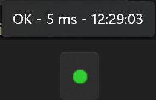
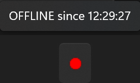

# ping-tray

**Un punto de color en la bandeja de Windows que te dice si tienes internet.**
*A tiny Windows tray dot that tells you, at a glance, whether your connection is alive. One readable PowerShell script, no install, no admin rights, ~100 KB/hour of traffic.*

| Color | Significa |
|---|---|
| 🟢 Verde | Conexión buena |
| 🟠 Naranja | Lenta (más de 400 ms) o un ping perdido suelto |
| 🔴 Rojo | Sin conexión (dos pings seguidos perdidos) |
| ⚪ Gris | Arrancando |


Al pasar el ratón por encima ves la latencia y la hora, o desde cuándo estás sin conexión:

 

## Para qué lo uso

Viajo mucho en tren y trabajo conectado al punto de acceso del móvil. Esa conexión va y viene: túneles, zonas sin cobertura, cambios de antena. Antes tenía siempre abierta una ventana con `ping -t 8.8.8.8` y la miraba cada vez que algo iba lento, para saber si el problema era la red o la página.

ping-tray hace lo mismo sin ventana: un vistazo a la bandeja y sabes si merece la pena esperar o si estás en un túnel.

## Qué hace exactamente

- Manda un ping de 8 bytes a `8.8.8.8` cada 3 segundos. Son unos **100 KB por hora**, frente a los ~430 KB/h de `ping -t` (un ping de 32 bytes por segundo).
- Tolera un ping perdido suelto (pasa a naranja, no a rojo), porque en una conexión móvil es normal y no significa que se haya caído.
- **No se instala, no necesita administrador** y **no cambia nada del sistema**: ni servicios, ni red, ni configuración. Lo único que puede crear, y sólo si se lo pides, es lo necesario para abrirse solo al iniciar sesión (con **Start with Windows**) y una clave en tu parte del registro para recordar que quieres sonido (con **Sound**).
- Son dos archivos: [`ping-tray.ps1`](ping-tray.ps1), el programa, y [`ping-tray.bat`](ping-tray.bat), una línea que lo arranca sin ventana. Léelos antes de usarlos.

## Cómo usarlo

Necesitas Windows 10 u 11. No hace falta instalar nada más. (Probado en Windows 11.)

### Opción A (recomendada): descargarlo

1. Entra en la [última release](https://github.com/vkthor/ping-tray/releases/latest) y descarga los dos archivos: **`ping-tray.ps1`** y **`ping-tray.bat`**.
2. Ponlos juntos en la misma carpeta, la que quieras (por ejemplo, `Documentos\ping-tray`).
3. Doble clic en **`ping-tray.bat`**. Aparece el punto en la bandeja (puede que tengas que abrir la flechita `^` para verlo; arrástralo fuera si lo quieres siempre a la vista).

### Opción B: con una sola línea

Hace lo mismo que la opción A, pero sin ir a la página: descarga los dos archivos a la carpeta `%LOCALAPPDATA%\ping-tray` y lo arranca. `%LOCALAPPDATA%` es una carpeta de tu usuario que normalmente está en `C:\Users\<tu usuario>\AppData\Local`, así que los archivos quedan en `C:\Users\<tu usuario>\AppData\Local\ping-tray`. Abre PowerShell (clic derecho en el botón de Inicio → **Terminal**) y pega:

```powershell
$d = "$env:LOCALAPPDATA\ping-tray"; mkdir $d -Force > $null; 'ping-tray.ps1', 'ping-tray.bat' | ForEach-Object { irm "https://github.com/vkthor/ping-tray/releases/latest/download/$_" -OutFile "$d\$_" }; & "$d\ping-tray.bat"
```

Aparece el punto y ya puedes cerrar la ventana. A partir de ahí funciona igual que con la opción A, también sin conexión. Para volver a arrancarlo, doble clic en `ping-tray.bat` de esa carpeta (o marca **Start with Windows**). Si vuelves a pegar la línea, descarga la última versión encima.

### El menú

Clic en el punto, con cualquiera de los dos botones (el menú está en inglés):

- **Start with Windows**: con marca, ping-tray se abre solo cada vez que inicias sesión en Windows. Se desmarca igual. También aparece en el Administrador de tareas, en **Aplicaciones de arranque**, como ping-tray, y lo puedes activar o desactivar desde ahí: la marca del menú se pone de acuerdo con lo que elijas. Recuerda en qué carpeta está el script: si lo mueves de carpeta, desmárcalo y vuelve a marcarlo.
- **Sound**: con marca, suena un aviso cuando se corta la conexión (pasa a rojo) y otro distinto cuando vuelve. Un ping perdido suelto o un momento lento no suenan. Viene apagado; si lo activas, se acuerda para la próxima vez. Usa dos sonidos que ya trae Windows, del antiguo reconocimiento de voz, para no confundirlos con los avisos habituales. Como vienen grabados muy flojos, ping-tray los sube de volumen (sin cambiar el volumen de Windows); el nivel se ajusta en la configuración del script.
- **About**: versión y enlace a esta página.
- **Exit**: lo cierra.

Sólo puede haber una instancia (una copia en marcha) a la vez. Si lo lanzas otra vez mientras ya está funcionando, la segunda instancia detecta que la primera sigue en marcha y se cierra sola, sin hacer nada: siempre queda un único punto.

### Añadirlo al menú Inicio (opcional)

ping-tray no se añade solo al menú Inicio, pero puedes hacerlo con un comando. Abre PowerShell y pega esta línea, cambiando lo que va entre las primeras comillas por la carpeta donde tengas `ping-tray.bat` (tal como está, sirve para la opción B):

```powershell
$dir = "$env:LOCALAPPDATA\ping-tray"; $s = (New-Object -ComObject WScript.Shell).CreateShortcut("$([Environment]::GetFolderPath('Programs'))\ping-tray.lnk"); $s.TargetPath = "$dir\ping-tray.bat"; $s.WorkingDirectory = $dir; $s.WindowStyle = 7; $s.Save()
```

Por ejemplo, si lo tienes en `Documentos\ping-tray`, la línea empezaría por `$dir = "C:\Users\<tu usuario>\Documents\ping-tray";`.

Aparece **ping-tray** en la lista de aplicaciones del menú Inicio, y desde ahí puedes anclarlo. Lleva el icono genérico de los `.bat`. Si mueves la carpeta, quítalo y vuelve a crearlo. Para quitarlo:

```powershell
Remove-Item "$([Environment]::GetFolderPath('Programs'))\ping-tray.lnk"
```

### Quitarlo

Desmarca **Start with Windows** y **Sound**, pulsa **Exit** y borra la carpeta (con la opción B, la carpeta es `C:\Users\<tu usuario>\AppData\Local\ping-tray`; para llegar rápido, escribe `%LOCALAPPDATA%\ping-tray` en la barra de direcciones del Explorador de archivos). Si lo añadiste al menú Inicio, quítalo también con el comando de arriba. No queda nada más.

## Cambiar el destino u otros ajustes

Abre `ping-tray.ps1` con el Bloc de notas. Al principio está la configuración: a quién se hace ping, cada cuánto, cuánto se espera la respuesta, a partir de cuántos milisegundos se considera lento, y qué sonidos se usan y a qué volumen. Cambia lo que quieras, guarda, y sal y vuelve a arrancar el punto.

## Por qué un `.ps1` y no un `.exe`

Porque cualquiera puede abrirlo y ver lo que hace. Un programa que corre siempre en segundo plano y usa la red debería poder leerse en cinco minutos.

Además, con cualquiera de las dos opciones lo que se ejecuta es siempre la copia que tienes en tu PC, no algo descargado en ese momento. Así el indicador arranca aunque no haya internet, que es justo cuando más falta hace.

## Preguntas

**¿Por qué 8.8.8.8?** Es el DNS de Google, responde a ping desde casi cualquier red y casi nunca se cae. Puedes cambiarlo a `1.1.1.1` (Cloudflare) en la configuración del script.

**Windows dice que el script no está firmado o que no se puede ejecutar.** Windows bloquea por defecto los scripts de PowerShell. El `.bat` usa `-ExecutionPolicy Bypass` sólo para este script, sin cambiar la política del sistema.

**Windows muestra un aviso de seguridad al abrir el `.bat`.** Windows marca los archivos descargados de internet, y al abrir un `.bat` descargado puede preguntar si quieres ejecutarlo («Advertencia de seguridad» o «Windows protegió su PC»). Es normal en cualquier programa descargado que no sea de una tienda. Para que no vuelva a preguntar: clic derecho en `ping-tray.bat` → **Propiedades** → marca **Desbloquear** → **Aceptar**. Haz lo mismo con `ping-tray.ps1`.

**El antivirus avisa o bloquea ping-tray.** Algunos antivirus desconfían de cualquier PowerShell que se ejecute sin ventana, porque es algo que también hacen programas maliciosos. ping-tray no descarga nada y no envía nada más que los pings. Si tu antivirus lo bloquea, lee el script y, si te convence, añádelo a sus excepciones.

**Al hacer doble clic en el `.bat` (o al iniciar sesión, con Start with Windows) se ve una ventana negra un instante.** Es normal: es el propio `.bat` cerrándose. El punto se queda funcionando sin ventana.

**¿Funciona con VPN?** Sí. Mide si llegas a internet por el camino que esté usando el PC en ese momento.

## Licencia

[GPL-3.0](LICENSE). Autor: VkThor.
